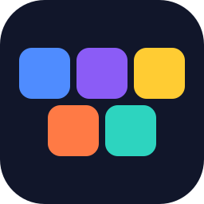

<h1 align="center">Craft Tools — MCP for Antigravity × ArtCraft</h1>

<p align="center">
  
</p>

<p align="center">
  <b>One Antigravity plugin. Five creative apps. All through MCP.</b><br>
  Connect your AI agent to FigCraft, FilmCraft, AniCraft, EffectCraft, and VectorCraft.
</p>

<p align="center">
  
  
  
</p>

**Craft Tools** is a community [Antigravity](https://antigravity.google/docs/plugins) plugin that bundles local **Model Context Protocol (MCP)** servers for five [ArtCraft](https://getartcraft.com/) creative apps. It lets an AI agent inspect, edit, animate, render, and export real projects using the same commands as the app UI.

> Unofficial community project. Not affiliated with ArtCraft or Google.

## Quick start

```sh
agy plugin install https://github.com/mahendartea/craft-tools
agy plugin list
```

Then open Antigravity and ask:

> Use EffectCraft to inspect my open project and render a preview.

Or invoke the bundled skill directly:

```text
/craft-tools
```

## What's included

| MCP server | App | What the agent can do |
| --- | --- | --- |
| `figcraft` | **FigCraft** | Interface design: frames, layers, components, prototypes |
| `filmcraft` | **FilmCraft** | Non-linear video editing, colour, audio, render and export |
| `anicraft` | **AniCraft** | 2D animation: timeline, tweens, symbols, GIF/video export |
| `effectcraft` | **EffectCraft** | Motion graphics: comps, layers, effects, keyframes, render queue |
| `vectorcraft` | **VectorCraft** | Vector illustration: paths, shapes, artboards, gradients, export |

The plugin also ships the `craft-tools` skill, so Antigravity knows when to reach for each app and how to work safely inside it.

## Tool names

Antigravity namespaces bundled MCP tools as:

```text
craft-tools_<server>_<tool>
```

Examples:

| Tool | Used for |
| --- | --- |
| `craft-tools_anicraft_anicraft_document` | Inspect the open AniCraft document |
| `craft-tools_effectcraft_get_project` | Inspect the EffectCraft project |
| `craft-tools_effectcraft_render_frame` | Render a preview frame |
| `craft-tools_figcraft_inspect_document` | Inspect a FigCraft document |
| `craft-tools_filmcraft_sequence_inspect` | Inspect a FilmCraft sequence |
| `craft-tools_vectorcraft_inspect_document` | Inspect a VectorCraft document |
| `craft-tools_vectorcraft_render_preview` | Render a VectorCraft preview |

## Example prompts

- *"Inspect this AniCraft file, add a 2-second bounce, and export a GIF."*
- *"Open my EffectCraft project, add a title animation, and render a 3-second preview."*
- *"Summarize the frames, layers, and components in this FigCraft document."*
- *"Cut the first 10 seconds of this FilmCraft sequence and export H.264."*
- *"Inspect this VectorCraft document, clean up the paths, and export a PDF."*

## Requirements

Craft Tools is built for **macOS** and expects the five apps plus their MCP wrapper scripts to be available on the machine.

| Requirement | Notes |
| --- | --- |
| macOS 11+ | The desktop apps are macOS builds |
| [Antigravity](https://antigravity.google/docs/plugins) | App, CLI, or IDE extension |
| FigCraft, FilmCraft, AniCraft, EffectCraft, VectorCraft | Installed locally |
| Wrapper scripts | `figcraft-mcp`, `filmcraft-mcp`, `anicraft-mcp`, `effectcraft-mcp`, `vectorcraft-mcp` |

Check the wrappers:

```sh
ls -l ~/.local/bin/figcraft-mcp ~/.local/bin/filmcraft-mcp \
      ~/.local/bin/anicraft-mcp ~/.local/bin/effectcraft-mcp \
      ~/.local/bin/vectorcraft-mcp
```

Each wrapper starts that app's own CLI/MCP server. AniCraft runs headless. FigCraft, FilmCraft, EffectCraft, and VectorCraft automatically attach to the running app when its control port is available; otherwise they fall back to a headless engine.

## Live mode

Start the app with its control server, then reconnect the Antigravity session so the plugin's MCP bridge attaches:

| App | Command | Control port |
| --- | --- | --- |
| FigCraft | `figcraft-live` | `8765` |
| FilmCraft | `filmcraft-live` | `9876` |
| EffectCraft | `effectcraft-live` | `9877` |
| VectorCraft | `vectorcraft-live` | `7979` |
| AniCraft | — | headless only |

Live mode is optional. Without it, all five servers still run headless and can edit, render, and export files.

## Manual install

From a local clone:

```sh
git clone https://github.com/mahendartea/craft-tools
agy plugin validate --strict ./craft-tools
agy plugin install ./craft-tools
agy plugin list
```

To update an installed plugin, run the install command again.

## Troubleshooting

**The plugin is installed but the MCP tools don't appear**

```sh
agy plugin list
```

Make sure `craft-tools` is enabled, then restart the Antigravity session. In an interactive session, `/mcp` shows the connected MCP servers. In the App or IDE, open **Customizations → Installed**.

**Headless `agy -p` refuses MCP tools**

MCP calls need permission. Add an allow rule under `permissions.allow` in Antigravity settings, or run the specific task with `--dangerously-skip-permissions`.

**`command not found` or the server won't start**

One of the wrapper scripts is missing. Check the paths in the Requirements section and make sure each wrapper is executable (`chmod +x`).

**Live mode doesn't attach**

Start the app with its `*-live` command first, confirm the control port is listening, then restart the Antigravity session so the plugin reconnects to the bridge.

## Repository layout

```text
craft-tools/
├── plugin.json                 # Antigravity plugin manifest
├── mcp_config.json             # Five local MCP server definitions
├── README.md
├── assets/
│   └── logo.svg
└── skills/
    └── craft-tools/
        └── SKILL.md            # When and how to use each app
```

## FAQ

**Is this an MCP server for Antigravity?**
Yes. It is an Antigravity plugin that bundles five local stdio MCP servers and a skill. Install it with `agy plugin install`.

**Is this the same as the ArtCraft apps?**
No. The apps do the creative work; Craft Tools connects them to your AI agent through MCP.

**Does it work with Gemini CLI?**
Gemini CLI has been replaced by Antigravity CLI. Use Antigravity — this plugin is built for it.

**Is this official?**
No. It is an unofficial community plugin. The ArtCraft apps and Antigravity are separate products.

## Keywords

Antigravity MCP · ArtCraft MCP · FigCraft MCP · FilmCraft MCP · AniCraft MCP · EffectCraft MCP · VectorCraft MCP · craft-tools · AI creative agents · motion graphics automation · AI video editing · AI animation · vector illustration automation
